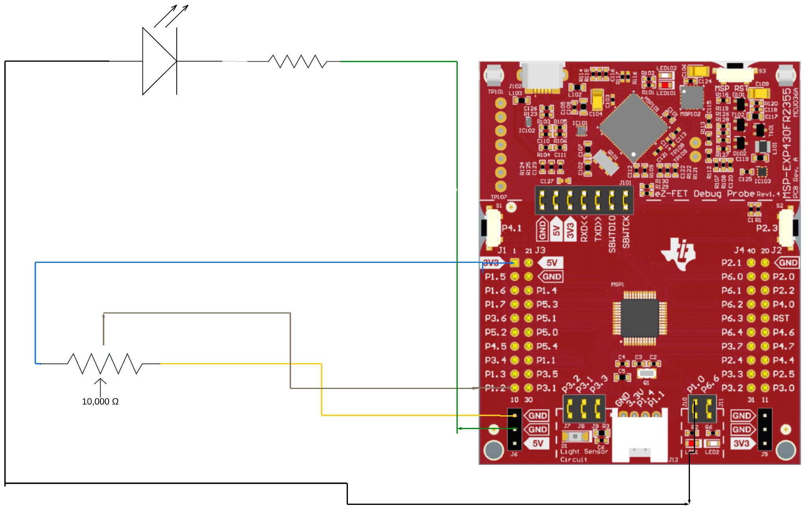

# MSP430 ADC LED Controller

An MSP430 assembly program that reads a potentiometer through the 12-bit ADC and uses the result to control an external LED's blink rate. Turning the potentiometer changes the delay between LED toggles.

[Watch the circuit demo](https://youtu.be/BePdgOvM-5g)

## Wiring

The potentiometer feeds analog input **P1.2 / A2**. The external LED is controlled through **P1.0**, with a series resistor.

## How it works

- Samples potentiometer voltage using the MSP430 ADC.
- Reads the 12-bit conversion result from `ADCMEM0`.
- Scales the reading and uses a nested software delay loop to set the LED toggle interval.
- Continuously samples the input so turning the knob changes the blink rate.

Lower ADC readings produce faster blinking; higher readings produce slower blinking. The cleaned version also handles a zero ADC reading without rolling the delay counter over.

## Run

Open `src/adc_led.asm` in an MSP430FR2355 assembly project in TI Code Composer Studio, connect the circuit as shown above, and build and flash the program.

The `original/` folder preserves the source recovered from the original report. `src/` contains a lightly cleaned version, keeping the same ADC and GPIO setup and the original delay algorithm.

## Background

Developed by Abdul Nafeh for an embedded systems assignment at the University of South Florida.